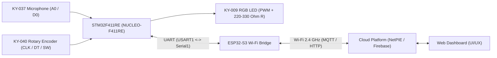

# Embedded System Lab — Final Project Progress Update

**วันที่อัปเดต:** พฤหัสบดีที่ 12 พฤศจิกายน 2569 (12 Nov 2026)  
**กลุ่ม:** `:)`  
**รายชื่อสมาชิก:**
- `6731315721` Natthakorn Yiengyongphan
- `6731332321` Poonnawit Supawasuwat
- `6731362121` Sukrit Kankrasang
- `6731365021` Aut Suttitanamongkol

---

## 1. คอนเซปต์โปรเจกต์ (Proposed Concept)

**FocusPulse — Smart Desk Noise & Focus Ambient Light**  
ระบบโคมไฟตั้งโต๊ะอัจฉริยะช่วยโฟกัสและตรวจวัดเสียงรบกวนรอบโต๊ะทำงานแบบ IoT โดยประมวลผลร่วมกันระหว่าง `STM32F411RE` และ `ESP32-S3` เชื่อมต่อกับระบบ Cloud และ Web Dashboard

### แนวทางการทำงานหลัก
- **`KY-037` (Microphone Sensor):** อ่านระดับความดังเสียงผ่าน Analog (`A0` → `ADC1`) และตรวจจับเสียงดังเกินเกณฑ์ผ่าน Digital Comparator (`D0`)
- **`KY-040` (Rotary Encoder + Switch):**
  - หมุนเพื่อปรับเกณฑ์เสียงเตือน (Noise Threshold) หรือปรับสี/ความสว่างของไฟ
  - กดปุ่ม `SW` เพื่อสลับโหมดการทำงาน (Focus Monitor / Ambient Light / Sound-Reactive)
- **`KY-009` (RGB SMD LED):** แสดงสถานะความดังเสียง (เขียว → เหลือง → แดง) และผสมสีโคมไฟด้วย Hardware PWM
- **สื่อสาร 2 ทาง (`STM32` ↔ `ESP32-S3` ผ่าน UART):**
  - ส่งข้อมูลความดังเสียง, โหมด, สีไฟปัจจุบัน และสถานะแจ้งเตือนขึ้น Cloud/Web Dashboard
  - รับคำสั่งเปลี่ยนโหมด, สี RGB, หรือ Threshold จาก Web Dashboard กลับมาควบคุมบอร์ด STM32

---

## 2. สรุปผลการตรวจรับและทดสอบฮาร์ดแวร์ (Completed / Verified)

รายการอุปกรณ์ที่เบิกตาม [Sensor & Actuator List (Public).xlsx](../Sensor%20%26%20Actuator%20List%20(Public).xlsx):
- **No. 34 (`KY-037`):** Sensitive microphone sensor module
- **No. 37 (`KY-040`):** Rotary encoder module
- **No. 8 (`KY-009`):** 3-color full-color LED SMD module

| รายการทดสอบ | สถานะ | วิธีทดสอบและผลลัพธ์ที่ยืนยันแล้ว | หมายเหตุ |
|---|---|---|---|
| **STM32 Board** (`NUCLEO-F411RE`) | ผ่าน | แฟลชโค้ดและส่ง Debug ออก `USART2` (`115200` baud) ผ่าน ST-Link Virtual COM (`/dev/tty.usbmodem21203`) สำเร็จ | — |
| **`KY-040`** Rotary Encoder | ผ่าน (การหมุน) | ทดสอบในโปรเจกต์ `test_ky_040` ใช้ `TIM3` (`Encoder Mode TI1 and TI2`, `Input Filter = 15`) พบว่าหมุน 1 กิ๊กค่า `raw` เปลี่ยนทีละ 2 (`54 → 70 → 53`) เพิ่ม/ลดทิศทางถูกต้อง | เหลือทดสอบกดปุ่ม `SW` (`Pull-up`) ยืนยันรีเซ็ตค่าเป็น `0` |
| **`KY-037`** Microphone Sensor | ผ่านครบ (`A0`, `D0`) | ทดสอบในโปรเจกต์ `test_ky_037` ใช้ `ADC1_IN0` (`PA0`) เก็บ Peak-to-Peak (`amp = max - min` ช่วง 50 ms) และ `PA1` อ่าน `D0`: ตอนเงียบ `amp ≈ 12–21` (`d0=1`), ตอนมีเสียงดัง `amp` พุ่งสูงสุด `4019` และ `d0` สลับเป็น `0` | สามารถจูนความไว `D0` เพิ่มเติมที่ตัวต้านทานปรับค่าได้สีฟ้า |
| **`KY-009`** RGB SMD LED | ผ่าน (ติดครบ 3 สี) | ทดสอบในโปรเจกต์ `test_ky_009` (โหมดสลับเปิดสั้น/duty ต่ำ) หลอดติดครบทั้ง แดง (`R`), เขียว (`G`), น้ำเงิน (`B`) | **ต้องขอ R `220Ω–330Ω` จำนวน 3 ตัว** จากพี่ TA สำหรับใช้งานจริงแบบ PWM |
| **`ESP32-S3`** Wi-Fi Bridge | ผ่าน (Wi-Fi + Internet) | ทดสอบในโปรเจกต์ `test_esp32_wifi` (Arduino IDE `ESP32S3 Dev Module`, อัปโหลดผ่านพอร์ต Native USB `/dev/cu.usbmodem21201` โดยเปิด `USB CDC On Boot: Enabled`): สแกน Wi-Fi รอบตัวได้, เชื่อมต่อ Wi-Fi 2.4 GHz (`RT-AX55-2G`) ได้ IP `192.168.50.102`, และยิง HTTP GET ออกอินเทอร์เน็ตได้ **`HTTP Status Code: 200`** | — |

---

## 3. แผนผังขาเชื่อมต่อสำหรับรวมระบบ (Planned Pin Mapping)

ออกแบบให้ไม่ชนกันระหว่างโมดูลทั้งหมดบน `NUCLEO-F411RE` และ `ESP32-S3`:

| อุปกรณ์ | ขาบนโมดูล | ขาที่กำหนดบน STM32 (`NUCLEO-F411RE`) / ESP32-S3 | หน้าที่ |
|---|---|---|---|
| **Power Rail** | `+` / `-` | `3V3` / `GND` (ต่อผ่าน Breadboard) | เลี้ยงไฟ `3.3V` และกราวด์ร่วมทุกบอร์ด |
| **`KY-040`** | `CLK`, `DT`, `SW` | `PA6` (`D12` / `TIM3_CH1`), `PA7` (`D11` / `TIM3_CH2`), `PA8` (`D7` / `GPIO_Input` Pull-up) | อ่านการหมุนและปุ่มกด |
| **`KY-037`** | `A0`, `D0` | `PA0` (`A0` / `ADC1_IN0`), `PA1` (`A1` / `GPIO_Input`) | อ่านความดังเสียงและ Threshold |
| **`KY-009`** | `R`, `G`, `B` *(ผ่าน R 220–330Ω)* | `PB6` (`D10` / `TIM4_CH1`), `PB8` (`D15` / `TIM4_CH3`), `PB9` (`D14` / `TIM4_CH4`) | ขับสี RGB แบบ PWM *(แยกจาก `TIM3` และหลีกเลี่ยง `PA9`/`PA10` ของ `USART1`)* |
| **Debug Serial** | USB ST-Link | `USART2` (`PA2` TX, `PA3` RX) | แสดง Log Debug ออกคอมพิวเตอร์ |
| **STM32 ↔ ESP32-S3** | UART Cross-over + `GND` | `STM32 USART1 TX (PA9 / D8)` → `ESP32-S3 RX (GPIO 18)` `STM32 USART1 RX (PA10 / D2)` ← `ESP32-S3 TX (GPIO 17)` `STM32 GND` ↔ `ESP32-S3 GND` | สื่อสารข้อมูล 2 ทางระหว่าง MCU ทั้งสองตัว |

---

## 4. การแบ่งหน้าที่ 4 คน (Role & Responsibility Blueprint)

อิงตามโครงสร้างใน [final_project_embedded_2026.pdf](../final_project_embedded_2026.pdf) เพื่อให้สมาชิกทุกคนมีทั้งงานพัฒนาและเนื้อหาสำหรับเขียนรายงาน (≥ 1 หน้า/คน):

| บทบาท | สมาชิกที่รับผิดชอบ | ขอบเขตงานหลัก | เนื้อหาหลักใน Final Report (≥ 1 หน้า) |
|---|---|---|---|
| **1. System Architecture & STM32 Core** | *(ระบุชื่อสมาชิก)* | ออกแบบวงจรรวม, Pinout, รวมโค้ดอ่าน `KY-037`/`KY-040` และขับ `KY-009` ด้วย PWM เป็น State Machine | System Architecture, Pinout/Schematic, Sensor Processing & PWM |
| **2. Embedded Bridge & Cloud (`ESP32-S3`)** | *(ระบุชื่อสมาชิก)* | พัฒนา UART Protocol 2 ทาง (`USART1` ↔ `Serial1`) และโค้ด `ESP32-S3` เชื่อมต่อ Cloud (NetPIE/Firebase) | UART Frame Format, Wi-Fi & Cloud Integration, Error/Reconnect Handling |
| **3. UI/UX & Web Dashboard** | *(ระบุชื่อสมาชิก)* | ออกแบบและพัฒนาหน้าเว็บแสดงค่าเสียง Real-time, แจ้งเตือน และปุ่มควบคุมสี/โหมดส่งกลับบอร์ด | UI/UX Design, Cloud API Integration (MQTT/REST), Interactive Controls |
| **4. Team Management, QA & Documentation** | *(ระบุชื่อสมาชิก)* | ดูแล Git Repo, ติดตามไทม์ไลน์, สรุป MCV รายสัปดาห์, ทดสอบความเสถียรของระบบ, จัดทำสคริปต์ Demo 4 นาทีและรูปเล่มรายงาน | Test Plan & Evaluation, Threshold Calibration, Project Management |

---

## 5. สิ่งที่ต้องทำต่อ & กำหนดการสำคัญ

### งานถัดไป (Next Steps)
1. ขอ **ตัวต้านทาน `220Ω–330Ω` จำนวน 3 ตัว** จากห้องแลปสำหรับ `KY-009`
2. ทดสอบสื่อสาร **UART 2 ทาง** ระหว่าง `STM32F411RE` (`USART1`) ↔ `ESP32-S3` (`Serial1`)
3. รวมโค้ดเซนเซอร์ทั้ง 3 ตัวลงโปรเจกต์หลักบน `STM32` และเปลี่ยน `KY-009` เป็น Hardware PWM
4. ตั้งค่า **Cloud (NetPIE / Firebase)** และสร้าง **Web Dashboard**
5. สร้าง **Git Repository (Public)** สำหรับเก็บ Source Code ตามข้อกำหนดส่งงาน

### กำหนดการสำคัญ
- **10–12 พ.ย. หรือ 17–19 พ.ย. 2569:** ส่ง Progress ที่ห้องแลป (เลือก 1 สัปดาห์ **ต้องมาครบทั้ง 4 คน**)
- **ทุกสัปดาห์:** ส่ง Progress Report (1 ย่อหน้า) บน **MCV**
- **ภายใน 19 พ.ย. 2569:** หากมีสมาชิกไม่ว่างในวันนำเสนอ 8 ธ.ค. ต้องอีเมลขอเลื่อนถึง `pitchaya@cp.eng.chula.ac.th` (`Cc: sukhum.s@cp.eng.chula.ac.th`) และแจ้ง TA
- **24 พ.ย. – 8 ธ.ค. 2569:** ช่วงสอบปลายภาค (ติดตามประกาศเวลา Office Hour)
- **อังคาร 8 ธ.ค. 2569 (เริ่ม 09:00 น.):** นำเสนอ Final Project กลุ่มละ 10 นาทีรวมถาม-ตอบ (เตรียม Demo ~4 นาที, **ต้องมาครบทุกคน**)

---

## 6. ข้อความสำหรับส่ง Progress บน MCV (สัปดาห์ที่ 1)

> **Week 1 Progress (Group `:)`):**  
> Our group finalized the project concept **"FocusPulse"**—a smart desk noise monitor and ambient RGB lamp built with `STM32F411RE` (`NUCLEO-F411RE`) and `ESP32-S3` connected to a Cloud web dashboard—and structured our 4-member team roles covering STM32/hardware integration, UART & Cloud firmware, Web UI/UX, and QA/project management. We collected all assigned components (`KY-037` microphone, `KY-040` rotary encoder, `KY-009` RGB SMD LED, and `ESP32-S3`) and completed unit hardware verification: `KY-040` rotation counting via `TIM3` encoder mode, `KY-037` analog peak-to-peak sampling (`ADC1`) and digital threshold (`D0`) detection, `KY-009` 3-channel RGB illumination test, and `ESP32-S3` 2.4 GHz Wi-Fi connection with successful HTTP internet access (`HTTP 200`). Next, we will obtain 220–330 Ohm current-limiting resistors for `KY-009`, establish bidirectional UART communication between `STM32` (`USART1`) and `ESP32-S3` (`Serial1`), set up our public Git repository, and connect the bridge to the Cloud platform.
